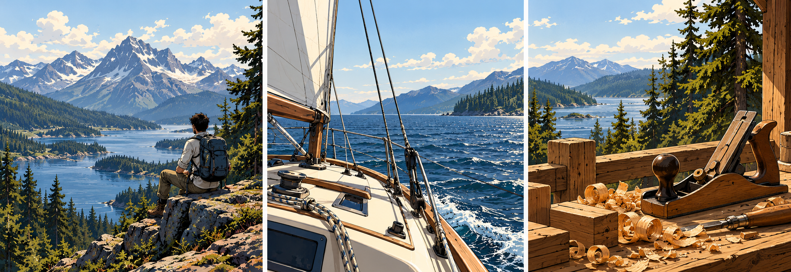

# Zaden Zeus

I build software and practical systems. Most of my projects start with something I want to make easier: running a small business, preparing a tabletop game, or getting everyday tools to work together.

## Selected work

<strong>SIGIL</strong> · characters, campaigns and tabletop tools

A workspace for characters, campaigns, compendium material and homebrew. There are a lot of rules and a lot of information at the table; I’m interested in making them easier to use during a game.

<strong>HELIX</strong> · private AI tools and automation

A collection of tools for local AI, personal workflows and the systems I use day to day.

I’m working on how these tools share context, keep useful records and let me inspect what happened. The source and personal integrations stay private.

<strong>ZD Printing</strong> · software meets physical production

My small 3D-printing business. It brings together product design, quoting, fulfilment and the software behind the workflow.

[Visit ZD Printing](https://zdprinting.com.au)

## What I work with

Python · Java · TypeScript · Django

## Off the screen

Hiking, sailing, woodworking, and usually another project for the tabletop.
