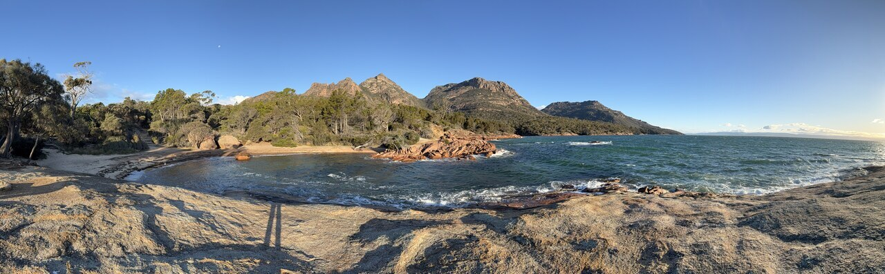
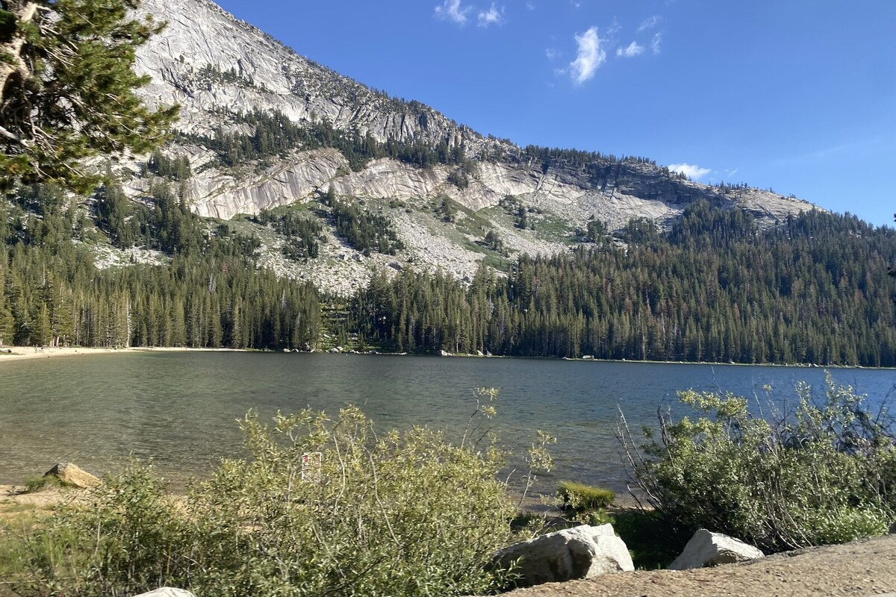

# Zaden Zeus

I build web applications, automation and practical systems. I’m the founder of **ZD Printing**, and I spend a lot of my time moving between software, hardware and the work needed to keep both useful.

My projects cover tabletop tools, private AI workflows and digital manufacturing. I like being involved in the whole thing: figuring out the problem, building the interface and backend, testing it, and dealing with what happens when someone actually uses it.

[Portfolio](https://zadenzeus.dev) · [ZD Printing](https://zdprinting.com.au)

## Selected work

### SIGIL

**Character, campaign and homebrew tools for tabletop games.**

I’m building SIGIL around the things I need when preparing and running a game: creating characters, keeping a live sheet usable, finding rules and keeping campaign material together.

- **The product:** character creation and sheets, campaigns, a searchable compendium and homebrew.
- **The engineering:** a shared TypeScript rules model, so the builder and sheet can use the same calculations for character choices and derived values.
- **My focus:** making complicated character choices understandable, keeping the rules consistent and testing the interactions between features.

There is an existing public product and an ongoing rebuild. My current rebuild work focuses on the character builder, live sheets and rules consistency.

### HELIX

**My private workspace for AI tools, automation and everyday software.**

HELIX brings together work on personal workflows, project context and tools that I run on my own infrastructure. It also includes a self-hosted productivity suite with mail, files and document editing.

- **The problem:** useful work and context end up scattered across applications and conversations.
- **What I’m building:** ways to recover the right project and session, retain useful records and connect tools without tying the whole system to one provider.
- **The engineering:** Python services, APIs, persistent storage and interfaces that make actions and approvals inspectable.

Different parts are at different stages. Some tools are in everyday use; others remain prototypes or testing builds. The source and personal integrations are private.

### ZD Printing

**The business where the software has to work alongside physical production.**

I founded and run a 3D-printing business, covering both the customer website and the work that turns a file into a finished object.

- **The platform:** Django and PostgreSQL, with enquiries, file uploads, quoting, Stripe payments, bookings, order management and customer communication.
- **The making:** CAD, slicing, FDM and resin printing, material selection, post-processing and quality control.
- **The operations:** customer scoping, printer troubleshooting, packing and fulfilment.

I’ve also worked on a modular tabletop terrain system. Running the business gives me a direct reason to improve the tools: I use the workflow myself and deal with the awkward parts of it.

## Tools I use

| Area | Tools and technologies |
| :--- | :--- |
| Languages | Python, TypeScript, JavaScript, Java, SQL, HTML/CSS |
| Web applications | Django, FastAPI, React, REST APIs, WebSockets |
| Data and infrastructure | PostgreSQL, Git, Docker, Linux |
| AI and automation | Local models, Ollama, Whisper, retrieval and workflow tooling |
| Design and fabrication | CAD, Blender, FDM and resin printing, prototyping |

<strong>More about how I work</strong>

I move between interface work, backend services and the infrastructure that runs them. I’m particularly interested in software that makes a real workflow less awkward, and in keeping enough evidence to understand why a system did something.

Beyond software, my experience includes technical support, corporate video production and editing, tabletop events and stage production. Those are different kinds of work, but each involves making something usable for other people and handling the practical details.

## Away from the screen

Hiking, sailing, woodworking and the outdoors are a big part of what I enjoy. I also spend time preparing tabletop games and making things for the table. These are a few photos from my camera roll.

 

